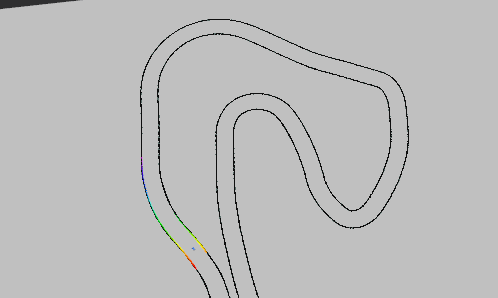
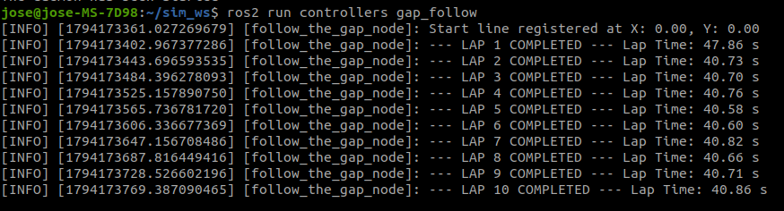

# 🏎️ Control Reactivo "Follow the Gap" para F1Tenth

**Estudiante:** Jose Augusto Moreno Maldonado  
**Asignatura:** Vehículos No Tripulados  
**Pista / Circuito:** Zandvoort  
**Repositorio Oficial:** [Proyecto-Follow-the-Gap-F1Tenth-VEHICULOS-NO-TRIPULADOS](https://github.com/JoseMorenoMaldonado/Proyecto-Follow-the-Gap-F1Tenth-VEHICULOS-NO-TRIPULADOS)

Un proyecto de **ROS 2** que implementa un controlador autónomo **Follow the Gap** para el simulador **F1Tenth**, probado en la pista **Zandvoort**.

---

## 🎯 Objetivo del Proyecto

Este proyecto implementa un **controlador reactivo "Follow the Gap"** en un nodo de **ROS 2** para el simulador oficial de **F1Tenth**.  
El objetivo es recorrer la pista *Zandvoort* y completar **10 vueltas** en el menor tiempo posible **sin colisiones**.

El proyecto incluye la integración de control y telemetría:

- **`gap_follow`** → Nodo de control autónomo reactivo y medición de tiempos por vuelta vía `/ego_racecar/odom`.

---

## 💡 Enfoque Utilizado: Follow the Gap

El enfoque **Follow the Gap** es una técnica reactiva de evasión de obstáculos basada en los datos del **LiDAR**.  
Su funcionamiento en este proyecto es el siguiente:

1. 🛰️ **Detección del entorno:** El LIDAR identifica paredes y obstáculos en tiempo real en el rango frontal de 180°.  
2. 🗺️ **Mapeo de espacios (Gaps):** Analiza los datos del LIDAR para encontrar huecos seguros por donde pasar.  
3. 🏆 **Selección del mejor “Gap”:** Elige el espacio más amplio y seguro (el gap con la mayor distancia navegable).  
4. 🧭 **Ajuste de trayectoria:** Dirige el vehículo hacia la combinación del centro del gap y la máxima profundidad.  
5. 🏎️ **Control de velocidad:** Ajusta la velocidad dinámicamente en función del ángulo de dirección, respetando un mínimo y un máximo.

---

## 🎥 Demostración y Resultados

### 📹 Simulación en Zandvoort


### 📊 Telemetría de 10 Vueltas (Best Lap: 40.58s)


---

## 📂 Contenido del Repositorio

```text
Proyecto-Follow-the-Gap-F1Tenth-VEHICULOS-NO-TRIPULADOS/
├── controllers/
│   ├── __init__.py
│   └── gap_follow.py        # Nodo de control reactivo y telemetría de vueltas
├── resource/
│   └── controllers
├── package.xml               # Configuración de dependencias ROS 2
├── setup.cfg
├── setup.py                  # Puntos de entrada (entry_points)
└── README.md
```

### 📦 Descripción de los paquetes

- **`controllers`**  
  Contiene el nodo desarrollado para el control autónomo y el cronometraje:  
  - `gap_follow.py`: Nodo principal que recibe datos de `/scan` (LiDAR) y `/ego_racecar/odom` (Odometría), y publica comandos de control en `/drive`.

---

## ⚙️ Estructura del Controlador (`gap_follow.py`)

### 🧩 Suscripción a `/scan` y `/ego_racecar/odom`

```python
self.scan_sub = self.create_subscription(
    LaserScan,
    '/scan',
    self.scan_callback,
    10
)

self.odom_sub = self.create_subscription(
    Odometry,
    '/ego_racecar/odom',
    self.odom_callback,
    10
)
```

### 🚗 Publicación en `/drive`

```python
self.drive_pub = self.create_publisher(
    AckermannDriveStamped,
    '/drive',
    10
)
```

### ⚙️ Parámetros del Controlador

```python
self.BUBBLE_RADIUS = 0.60       # Radio de la burbuja de seguridad
self.PREPROC_MAX_DIST = 4.5     # Filtrado de distancia máxima del LiDAR
self.SAFE_DIST_THRESHOLD = 1.2  # Umbral de espacio navegable libre
self.MAX_STEER_ANGLE = 0.4189   # ≈ 24 grados en radianes
self.MAX_SPEED = 10.0           # Velocidad máxima en rectas (m/s)
self.MIN_SPEED = 1.0            # Velocidad mínima en curvas (m/s)
```

---

## 🧠 Lógica Principal

### `scan_callback(scan_msg: LaserScan)`

Procesa los datos del LiDAR y publica el comando de control:

```python
def scan_callback(self, scan_msg):
    proc_ranges, offset_idx = self.preprocess_lidar(
        scan_msg.ranges, scan_msg.angle_min, scan_msg.angle_increment
    )
    
    # Identificar obstáculo más cercano e inflar Safety Bubble
    closest_idx = np.argmin(proc_ranges)
    closest_dist = proc_ranges[closest_idx]
    
    angle_per_index = scan_msg.angle_increment
    if closest_dist > 0:
        bubble_angle_span = np.arctan2(self.BUBBLE_RADIUS, closest_dist)
        bubble_index_span = int(np.ceil(bubble_angle_span / angle_per_index))
    else:
        bubble_index_span = 10
        
    b_start = max(0, closest_idx - bubble_index_span)
    b_end = min(len(proc_ranges), closest_idx + bubble_index_span)
    proc_ranges[b_start:b_end] = 0.0
    
    # Buscar el mayor gap y seleccionar el objetivo
    gap_start, gap_end = self.find_max_gap(proc_ranges)
    best_idx_relative = self.find_best_point(gap_start, gap_end, proc_ranges)
    best_idx_global = offset_idx + best_idx_relative
    
    # Calcular ángulo de dirección y perfil dinámico de velocidad
    steering_angle = scan_msg.angle_min + (best_idx_global * scan_msg.angle_increment)
    steering_angle = np.clip(steering_angle, -self.MAX_STEER_ANGLE, self.MAX_STEER_ANGLE)
    
    speed = self.MAX_SPEED * (1.0 - (abs(steering_angle) / self.MAX_STEER_ANGLE)**2.2)
    speed = max(self.MIN_SPEED, speed)
    
    # Publicar comando de control
    drive_msg = AckermannDriveStamped()
    drive_msg.header.stamp = self.get_clock().now().to_msg()
    drive_msg.drive.steering_angle = float(steering_angle)
    drive_msg.drive.speed = float(speed)
    self.drive_pub.publish(drive_msg)
```

### `find_max_gap(free_space_ranges)`

Encuentra el inicio y el fin del gap más amplio en el rango filtrado:

```python
def find_max_gap(self, free_space_ranges):
    masked = free_space_ranges > self.SAFE_DIST_THRESHOLD
    gap_starts = np.where(np.diff(np.pad(masked.astype(int), (1, 1))) == 1)[0]
    gap_ends = np.where(np.diff(np.pad(masked.astype(int), (1, 1))) == -1)[0]
    
    if len(gap_starts) == 0:
        max_idx = np.argmax(free_space_ranges)
        return max_idx, max_idx
    
    gap_lengths = gap_ends - gap_starts
    best_gap_idx = np.argmax(gap_lengths)
    
    return gap_starts[best_gap_idx], gap_ends[best_gap_idx] - 1
```

---

## 🚀 Instalación y Ejecución

### 1. Prerrequisitos

- **ROS 2 (Humble / Iron)** en Ubuntu 22.04 LTS.
- **Simulador F1Tenth** (`f1tenth_gym_ros`) configurado en la pista **Zandvoort**.

---

### 2. Ejecución de la Simulación

> ⚠️ **Importante:** En cada terminal, haz `source` de tu workspace antes de ejecutar cualquier comando.

```bash
cd ~/sim_ws
source /opt/ros/humble/setup.bash
source install/setup.bash
```

Luego, abre **dos terminales** y ejecuta:

#### 🧱 Terminal 1: Lanzar el Simulador
```bash
ros2 launch f1tenth_gym_ros gym_bridge_launch.py
```

#### 🤖 Terminal 2: Ejecutar el Controlador y Cronómetro
```bash
ros2 run controllers gap_follow
```

Una vez ejecutado el nodo, el vehículo **comenzará a moverse autónomamente por la pista de Zandvoort** registrando los tiempos por vuelta en la consola.
